# Panopticon Diagram Set

The complete UML and software-architecture diagram set for the **Panopticon&Co** endpoint
detection platform, a cybersecurity capstone/research project. Twenty-two diagrams (the
sixteen-diagram specification suite plus the six-diagram Manager capstone set), each one
derived from the code and documents in `panopticon-agent`, `panopticon-linux-agent`,
`panopticon-manager`, `panopticon-detection-engine`, `panopticon-response-engine`,
`panopticon-contracts`, and `panopticon-console`, and verified against reconciled working trees.

**Status:** actively maintained documentation repository. It ships no runnable service —
every diagram is a static, hand-authored HTML/SVG file — and its accuracy is enforced by an
automated consistency gate (`_tooling/validate.py`) that runs in CI against the current
source of the repositories it describes.

The governing contract for this set is [`DIAGRAM_SPECIFICATION.md`](DIAGRAM_SPECIFICATION.md).
Read it before changing any diagram. It records the source-of-truth hierarchy, the
terminology, the consistency rules every diagram obeys, the assumptions, and the reconciled
discrepancies between the repositories' documentation and their implementation.

See [`CONTRIBUTING.md`](CONTRIBUTING.md) for the actual (hand-authored, no-DSL) diagram
workflow, [`SECURITY.md`](SECURITY.md) for how to report a security concern, and
[`LICENSE`](LICENSE) (MIT) for the terms this repository is distributed under.

---

## Why this is a separate repository

This diagram set lives in its own repository, sibling to `panopticon-agent`,
`panopticon-linux-agent`, `panopticon-detection-engine`, `panopticon-response-engine`,
`panopticon-manager`, and `panopticon-console`, because it spans all of them. Putting
the detection-engine class model inside `panopticon-agent`, for instance, would violate the
project's one-way polyrepo boundary. Nothing here is imported by any of those repositories'
builds; the relationship runs the other way — every diagram here is derived from their code
and documentation.

---

## What is in the set

Every diagram ships as three files with the same basename: a self-contained **`.html`**
source, a standalone **`.svg`**, and a 2x **`.png`**.

### Capstone architecture & response set

| Diagram | File | What it answers |
|---|---|---|
| Capstone Architecture | [`manager-capstone-set/01-architecture.html`](manager-capstone-set/01-architecture.html) | Running components across Windows Officer, Linux Agent, Manager control plane, and Console, crossing trust boundaries. |
| Capstone UML Class | [`manager-capstone-set/02-uml-class.html`](manager-capstone-set/02-uml-class.html) | Static object model across agent C++, detection engine Python, and the response engine policy contract. |
| Capstone Level-1 DFD | [`manager-capstone-set/03-data-flow.html`](manager-capstone-set/03-data-flow.html) | Full telemetry ingestion, SQLite WAL stores (D1–D5), alert/incident querying, and response command loop. |
| Capstone Use Case | [`manager-capstone-set/04-use-case.html`](manager-capstone-set/04-use-case.html) | Platform use cases from telemetry streaming to analyst authorization and endpoint action execution. |
| Capstone Sequence | [`manager-capstone-set/05-sequence.html`](manager-capstone-set/05-sequence.html) | End-to-end trace: Ingest batch &rarr; fast commit/ack &rarr; async detection &rarr; analyst approval &rarr; command dispatch &rarr; evidence. |
| Capstone Activity | [`manager-capstone-set/06-activity.html`](manager-capstone-set/06-activity.html) | Partitioned workflow of an event across Endpoint Agent, Manager API, Detection Worker, and SOC Analyst. |

### Context and architecture

| Diagram | File | What it answers |
|---|---|---|
| System context | [`context/panopticon-system-context.html`](context/panopticon-system-context.html) | Who uses Panopticon, what it observes, and where its boundary is. Three human roles, one system actor, three external Windows systems. |
| High-level architecture | [`architecture/panopticon-high-level-architecture.html`](architecture/panopticon-high-level-architecture.html) | How a Windows event becomes a visible alert, in nine components across two zones, with bounded queues and SQLite WAL spooling. |
| Network ingestion | [`architecture/panopticon-network-ingestion.html`](architecture/panopticon-network-ingestion.html) | The implemented Officer-to-Manager HTTPS path, durable Manager event queue and detection worker, plus privilege boundaries. |

### UML specification suite

| Diagram | File | What it answers |
|---|---|---|
| Use case | [`uml/use-case/panopticon-use-case.html`](uml/use-case/panopticon-use-case.html) | What each role can actually do. Seven use cases, two `«include»` and one conditional `«extend»`. |
| Component | [`uml/component/panopticon-component.html`](uml/component/panopticon-component.html) | The deployable components and the cross-repository interface surfaces. |
| Agent class model | [`uml/class/agent/panopticon-agent-class-model.html`](uml/class/agent/panopticon-agent-class-model.html) | The Officer object model: collector interface, realizations, and the raw to enriched to normalized contract chain. |
| Detection engine class model | [`uml/class/detection-engine/panopticon-detection-engine-class-model.html`](uml/class/detection-engine/panopticon-detection-engine-class-model.html) | How a rule's recursive condition tree becomes a detection and alert via DetectionRun, RuleEvaluator, and ProvenanceGraph. |
| Telemetry collection sequence | [`uml/sequence/telemetry-collection/panopticon-telemetry-collection-sequence.html`](uml/sequence/telemetry-collection/panopticon-telemetry-collection-sequence.html) | One Sysmon event from the Windows callback to the consumer's bounded queue, including backpressure. |
| Detection sequence | [`uml/sequence/detection/panopticon-detection-sequence.html`](uml/sequence/detection/panopticon-detection-sequence.html) | One event dict through rule routing, alert construction, durable persistence and append, with delivery failure branches. |
| Response sequence | [`uml/sequence/response/panopticon-response-sequence.html`](uml/sequence/response/panopticon-response-sequence.html) | Closed-loop response authorization, lease-bound command dispatch, target verification, and execution. |
| End-to-end activity | [`uml/activity/panopticon-end-to-end-activity.html`](uml/activity/panopticon-end-to-end-activity.html) | The whole workflow with its real fork, its real decisions, and an honest ending. |
| Alert lifecycle state machine | [`uml/state/panopticon-alert-lifecycle-state.html`](uml/state/panopticon-alert-lifecycle-state.html) | The states the SQLite spool persists (PENDING, SENT, FAILED, RETRY), and the transitions between them. |
| Deployment | [`uml/deployment/panopticon-deployment.html`](uml/deployment/panopticon-deployment.html) | Elevated Windows host, execution environments, artifacts, and communication paths. |

### Data and investigation

| Diagram | File | What it answers |
|---|---|---|
| Event data model | [`data/event-data-model/panopticon-event-data-model.html`](data/event-data-model/panopticon-event-data-model.html) | Every block Schema 0.3 defines, with types and nullability, and the rule that exactly one family block must match the event category. |
| Process entity relationships | [`data/process-entity-relationships/panopticon-process-entity-relationships.html`](data/process-entity-relationships/panopticon-process-entity-relationships.html) | What can be joined to what during an investigation, and which join is strong versus heuristic. |
| Attack detection and investigation | [`investigation/panopticon-attack-detection-investigation.html`](investigation/panopticon-attack-detection-investigation.html) | One obfuscated PowerShell launch followed end to end across five lanes, with the exact rule logic that matched. |

---

## Visual Architecture & System Diagrams

The diagrams below are organized logically by architectural domain. Each diagram is rendered directly from the authoritative SVG vector asset, with companion links to the self-contained interactive HTML source and high-resolution 2× PNG export.

### 1. Overall System Architecture & Control Plane

#### Multi-Agent System Architecture & Closed-Loop Response
The high-level platform architecture showing running components across Windows and Linux endpoints, the FastAPI Manager control plane, and the Panopticon Console. Highlights trust boundaries, HTTPS ingest (`/api/v1/ingest`), lease-bound command polling (`/api/v1/commands`), and server-side decision proxies.


*Figure 1: Panopticon System Architecture and Closed-Loop Response ([Interactive HTML](manager-capstone-set/01-architecture.html) · [Vector SVG](manager-capstone-set/01-architecture.svg) · [High-Res PNG](manager-capstone-set/01-architecture.png))*

#### High-Level Pipeline Architecture
Traces how Windows telemetry events move through nine distinct pipeline components across two zones: endpoint collection, bounded queuing (1024 capacity), detection stages A through G, SQLite WAL spooling, and Console polling.

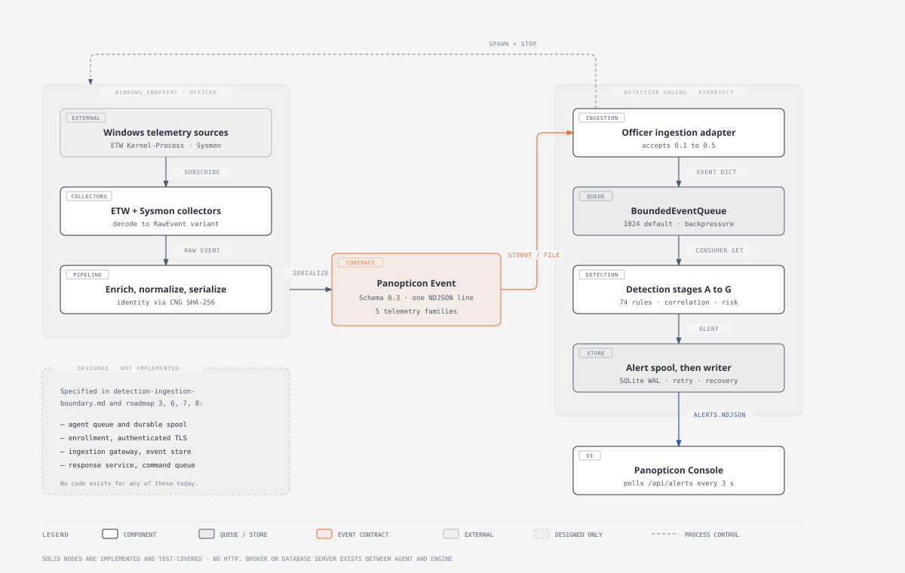

*Figure 2: Telemetry Pipeline Architecture from Endpoint to Console ([Interactive HTML](architecture/panopticon-high-level-architecture.html) · [Vector SVG](architecture/panopticon-high-level-architecture.svg) · [High-Res PNG](architecture/panopticon-high-level-architecture.png))*

#### Network Ingestion & Privilege Separation
Details the network ingest boundary between Officer and Manager over TLS 1.3, the event queue, the dedicated detection worker, and the privilege-separated host isolation architecture on Linux agents.

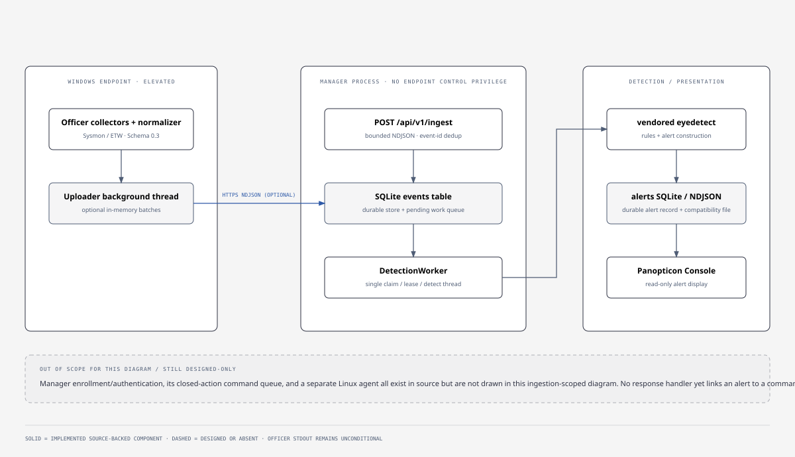

*Figure 3: Implemented Network Ingestion Path ([Interactive HTML](architecture/panopticon-network-ingestion.html) · [Vector SVG](architecture/panopticon-network-ingestion.svg) · [High-Res PNG](architecture/panopticon-network-ingestion.png))*

#### System Context
Models the boundary of the Panopticon platform with its human operators (Security Analyst, Detection Engineer, Security Admin) and external Windows/Linux subsystems.

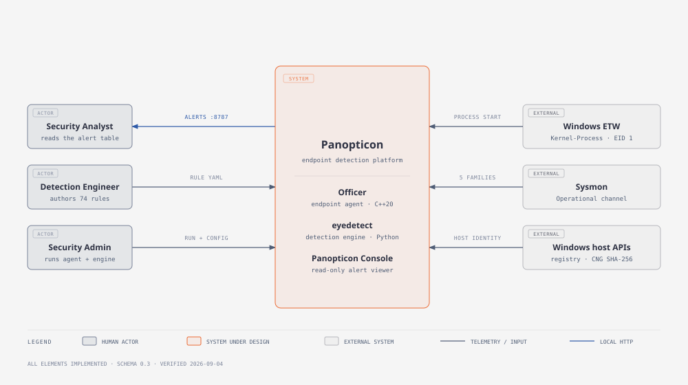

*Figure 4: Panopticon System Context ([Interactive HTML](context/panopticon-system-context.html) · [Vector SVG](context/panopticon-system-context.svg) · [High-Res PNG](context/panopticon-system-context.png))*

---

### 2. Component Architecture & Static Object Models

#### Deployable Components & Interface Surfaces
Models the deployable artifacts, executables, packages, and ball-and-socket interfaces connecting `panopticon-agent`, `panopticon-detection-engine`, `panopticon-manager`, and `panopticon-console`.

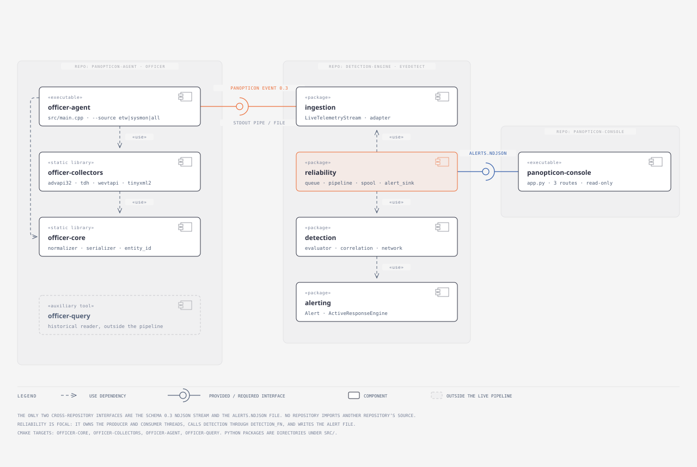

*Figure 5: Deployable Component Architecture ([Interactive HTML](uml/component/panopticon-component.html) · [Vector SVG](uml/component/panopticon-component.svg) · [High-Res PNG](uml/component/panopticon-component.png))*

#### Capstone Static Class Model
Comprehensive UML class diagram spanning the C++ endpoint agent, Python detection engine runtime (`DetectionRun`, `RuleEvaluator`, `ProvenanceGraph`), and the `panopticon-response-engine` policy domain.


*Figure 6: Capstone Cross-Service Class Model ([Interactive HTML](manager-capstone-set/02-uml-class.html) · [Vector SVG](manager-capstone-set/02-uml-class.svg) · [High-Res PNG](manager-capstone-set/02-uml-class.png))*

#### Officer Agent Class Model
Object-oriented class hierarchy of the Windows Officer agent (`panopticon-agent`): collectors, kernel callbacks, serializers, and the normalization pipeline.

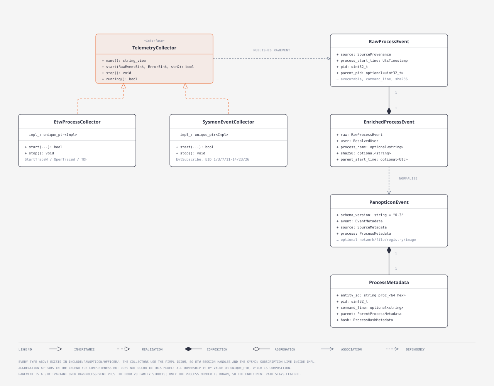

*Figure 7: Officer Agent Class Model ([Interactive HTML](uml/class/agent/panopticon-agent-class-model.html) · [Vector SVG](uml/class/agent/panopticon-agent-class-model.svg) · [High-Res PNG](uml/class/agent/panopticon-agent-class-model.png))*

#### Detection Engine Class Model
Detailed class diagram of `panopticon-detection-engine` showing how `DetectionRun` coordinates rule evaluation, logic nodes, conditions (14 operators), behavioral detectors, and incident correlation.

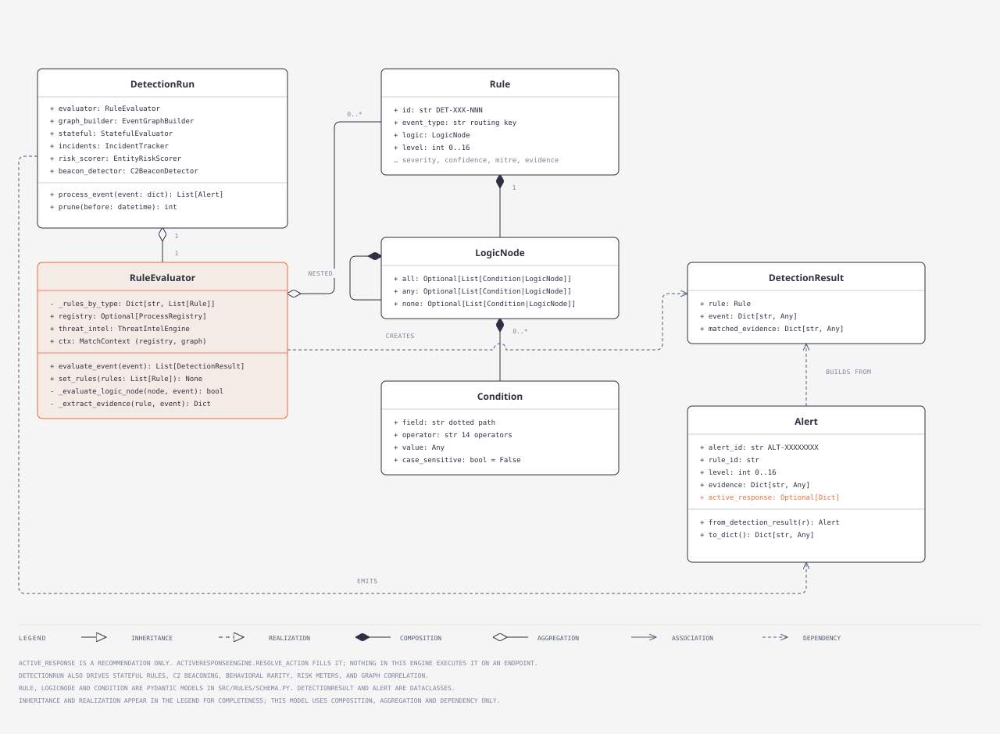

*Figure 8: Detection Engine Class Model ([Interactive HTML](uml/class/detection-engine/panopticon-detection-engine-class-model.html) · [Vector SVG](uml/class/detection-engine/panopticon-detection-engine-class-model.svg) · [High-Res PNG](uml/class/detection-engine/panopticon-detection-engine-class-model.png))*

---

### 3. Data Flow & Event Processing

#### Level-1 Data Flow Diagram (DFD)
Gane-Sarson style DFD tracking processes 1.0 through 6.0: collection, ingest buffering, rule detection & correlation, analyst console serving, response action authorization, and agent command execution against data stores D1–D5.

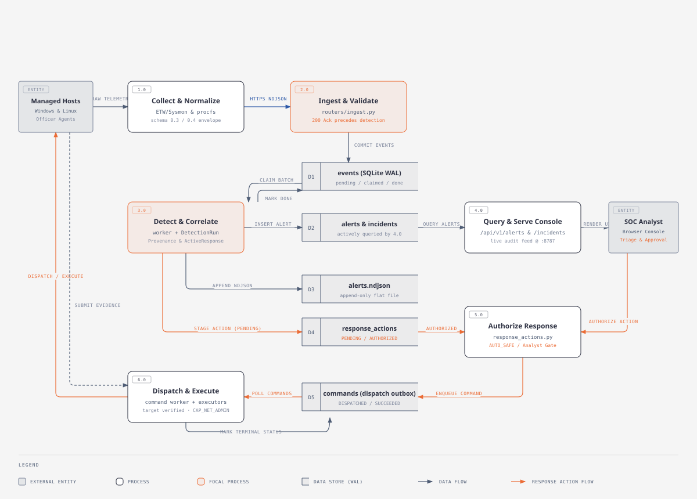

*Figure 9: Level-1 Data Flow Diagram ([Interactive HTML](manager-capstone-set/03-data-flow.html) · [Vector SVG](manager-capstone-set/03-data-flow.svg) · [High-Res PNG](manager-capstone-set/03-data-flow.png))*

#### Panopticon Event Data Model
Field-level schema definition for Panopticon Event Schema 0.3–0.5 showing envelope headers, process metadata, file/network blocks, and typed family structures.

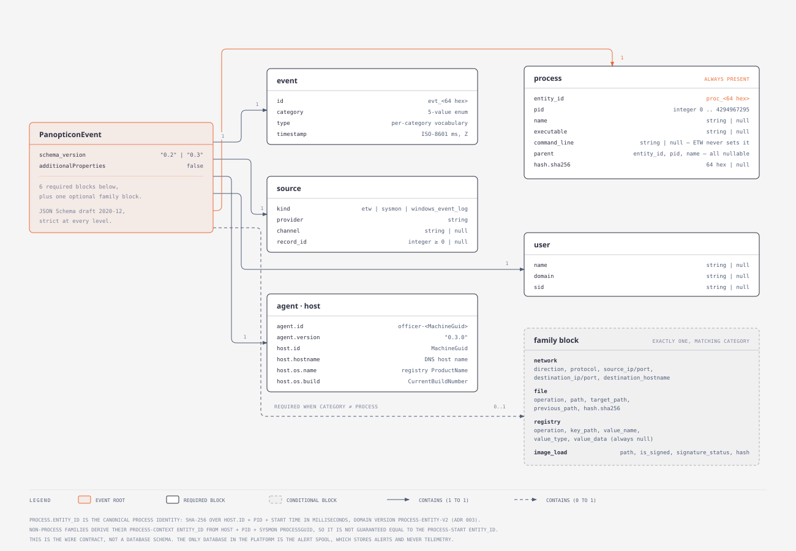

*Figure 10: Panopticon Schema Event Data Model ([Interactive HTML](data/event-data-model/panopticon-event-data-model.html) · [Vector SVG](data/event-data-model/panopticon-event-data-model.svg) · [High-Res PNG](data/event-data-model/panopticon-event-data-model.png))*

#### Process Entity Relationships & Join Heuristics
Entity relationship diagram mapping how processes, threads, sockets, and files are correlated during investigation, identifying strong joins versus heuristic linkages.

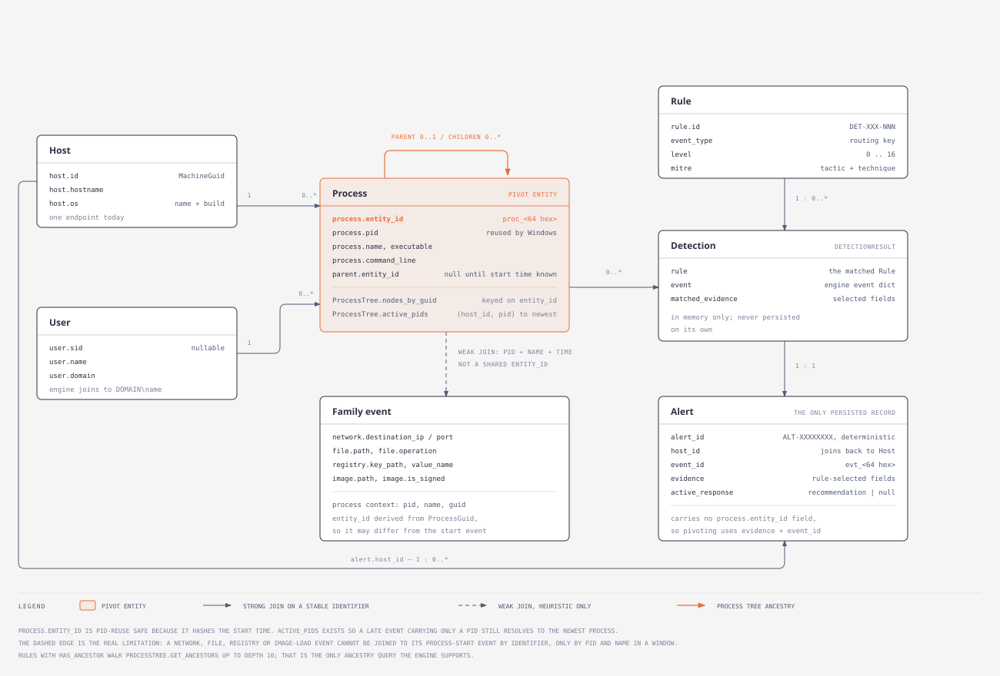

*Figure 11: Process Entity Relationships ([Interactive HTML](data/process-entity-relationships/panopticon-process-entity-relationships.html) · [Vector SVG](data/process-entity-relationships/panopticon-process-entity-relationships.svg) · [High-Res PNG](data/process-entity-relationships/panopticon-process-entity-relationships.png))*

---

### 4. End-to-End Activity & Ingestion Workflows

#### 4-Partition Lifecycle Activity
Partitioned activity diagram showing event lifecycles across four swimlanes: Endpoint Agent (collection), Manager API (ingest & persistence), Detection Worker (eval & correlation), and SOC Analyst (triage & decision).

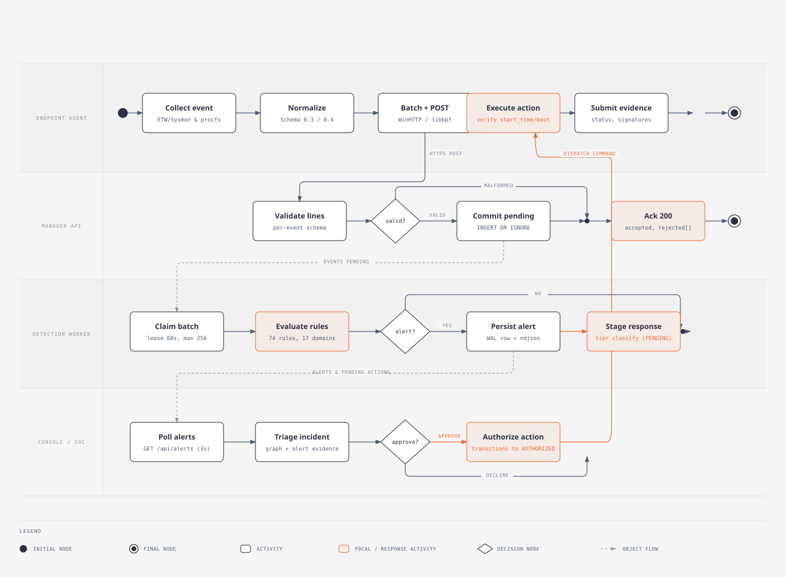

*Figure 12: Event & Response Lifecycle Activity Across 4 Partitions ([Interactive HTML](manager-capstone-set/06-activity.html) · [Vector SVG](manager-capstone-set/06-activity.svg) · [High-Res PNG](manager-capstone-set/06-activity.png))*

#### End-to-End Activity Workflow
UML activity flow showing decisions, forks, and synchronization joins during live event processing, deduplication, and alert staging.

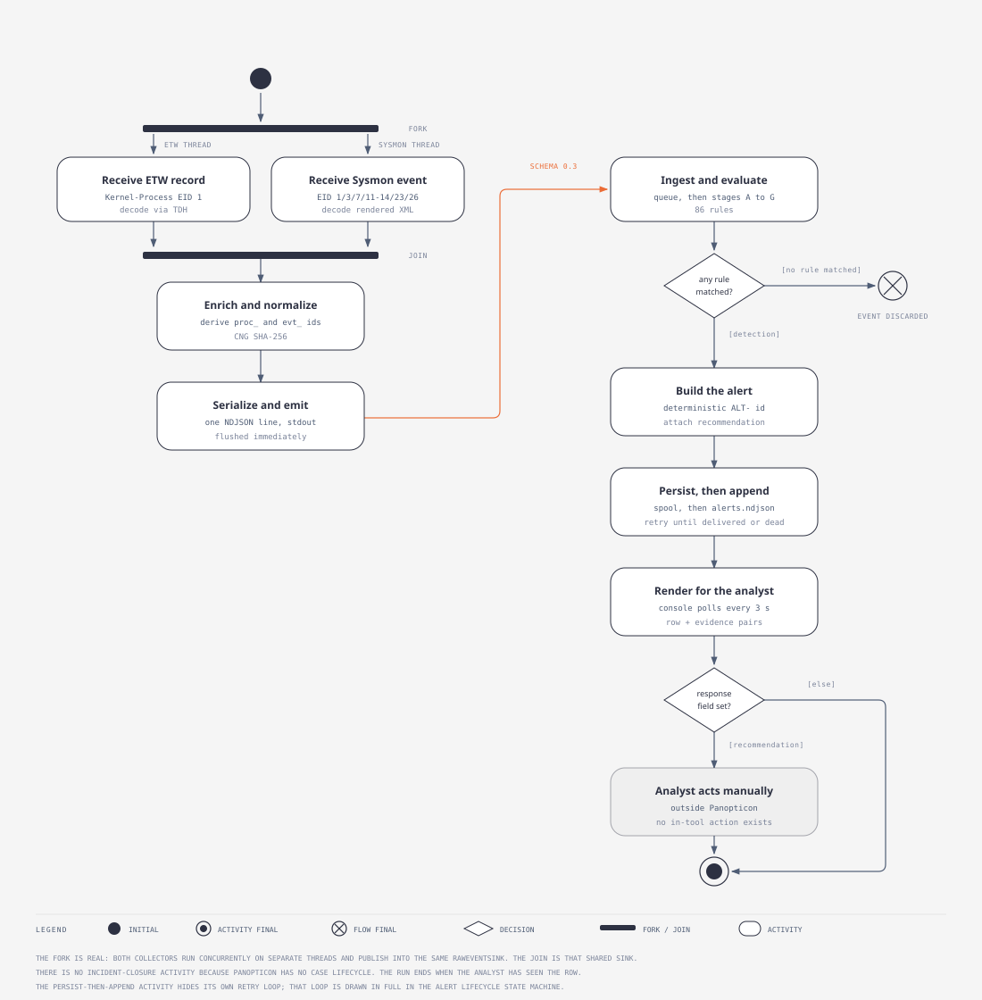

*Figure 13: End-to-End Telemetry Processing Activity ([Interactive HTML](uml/activity/panopticon-end-to-end-activity.html) · [Vector SVG](uml/activity/panopticon-end-to-end-activity.svg) · [High-Res PNG](uml/activity/panopticon-end-to-end-activity.png))*

#### Telemetry Collection Sequence
Sequence diagram detailing Windows kernel ETW and Sysmon callback handling, ring buffer extraction, and queue push with backpressure management.

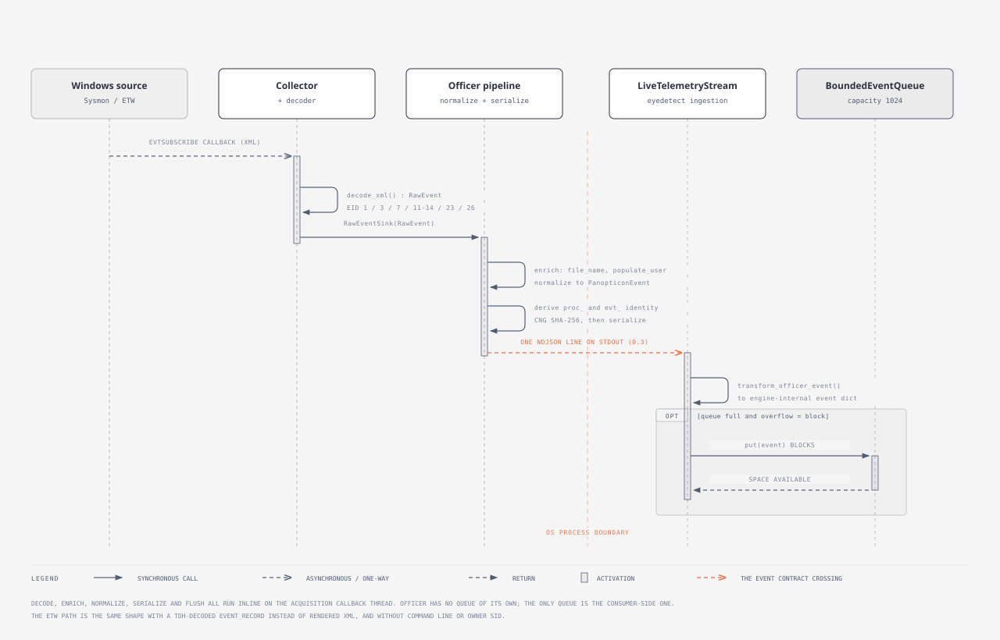

*Figure 14: Telemetry Collection Sequence ([Interactive HTML](uml/sequence/telemetry-collection/panopticon-telemetry-collection-sequence.html) · [Vector SVG](uml/sequence/telemetry-collection/panopticon-telemetry-collection-sequence.svg) · [High-Res PNG](uml/sequence/telemetry-collection/panopticon-telemetry-collection-sequence.png))*

---

### 5. Detection Engine Workflow, Rule Evaluation & Scenarios

#### Detection Pipeline Execution Sequence
Lifeline interaction showing one event dict through `RuleEvaluator`, condition matching, `C2BeaconDetector`, incident graph correlation, SQLite persistence, and NDJSON streaming.

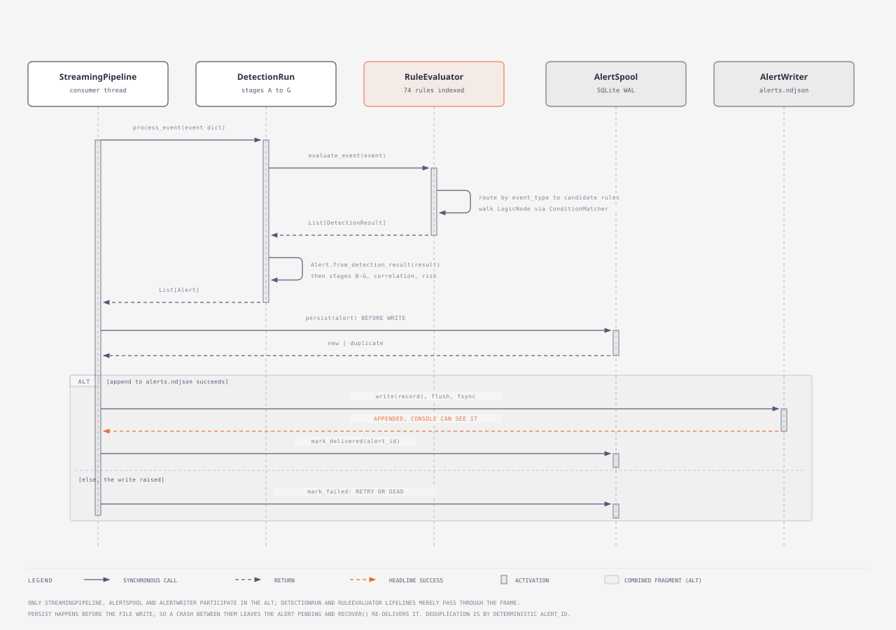

*Figure 15: Detection Pipeline Execution Sequence ([Interactive HTML](uml/sequence/detection/panopticon-detection-sequence.html) · [Vector SVG](uml/sequence/detection/panopticon-detection-sequence.svg) · [High-Res PNG](uml/sequence/detection/panopticon-detection-sequence.png))*

#### Attack Detection & Investigation Scenario
Complete five-lane attack walkthrough following an obfuscated PowerShell execution (`-enc`) matching rule `DET-PRC-001` (MITRE ATT&CK T1059.001) from raw event to investigation storyboard.

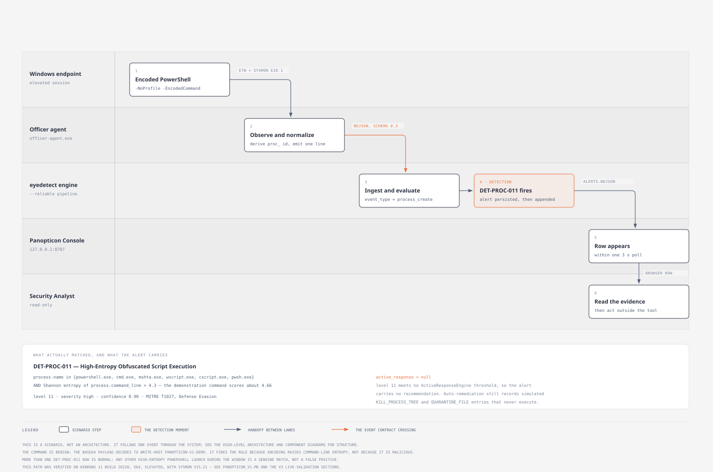

*Figure 16: Attack Detection and Investigation Walkthrough ([Interactive HTML](investigation/panopticon-attack-detection-investigation.html) · [Vector SVG](investigation/panopticon-attack-detection-investigation.svg) · [High-Res PNG](investigation/panopticon-attack-detection-investigation.png))*

---

### 6. Alert Lifecycle & Closed-Loop Response Workflow

#### Ingest, Detection & Response Command Sequence
Complete chronological sequence from batch ingestion commit/ack (ADR 002), async detection worker analysis, alert emission, analyst approval via Console, command queueing, and agent evidence return.

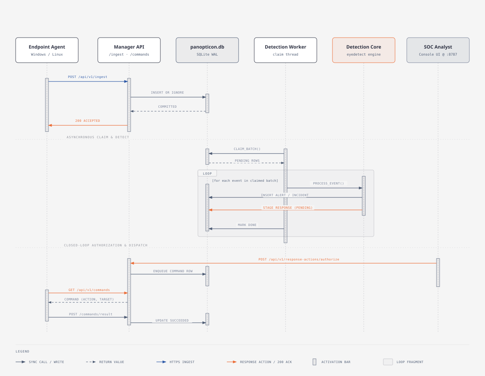

*Figure 17: Ingest, Detection & Response Sequence ([Interactive HTML](manager-capstone-set/05-sequence.html) · [Vector SVG](manager-capstone-set/05-sequence.svg) · [High-Res PNG](manager-capstone-set/05-sequence.png))*

#### Closed-Loop Response Sequence
Detailed sequence of response policy tiering (`AUTO_SAFE` vs `ANALYST_APPROVAL`), server-side bearer token proxying, lease-bound command dispatch, and target verification using PID + start time ticks.

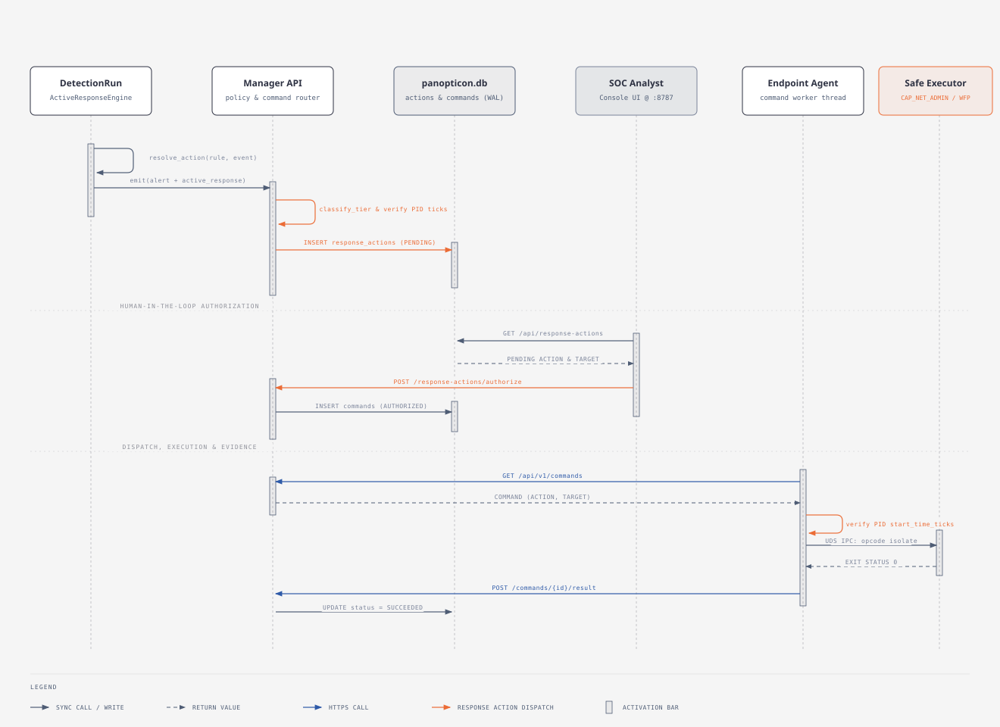

*Figure 18: Closed-Loop Response Sequence ([Interactive HTML](uml/sequence/response/panopticon-response-sequence.html) · [Vector SVG](uml/sequence/response/panopticon-response-sequence.svg) · [High-Res PNG](uml/sequence/response/panopticon-response-sequence.png))*

#### Alert Lifecycle State Machine
Finite state machine governing alert persistence in the SQLite spool: transitions between `PENDING`, `SENT`, `FAILED`, and `RETRY` under network partitioned and crash recovery conditions.

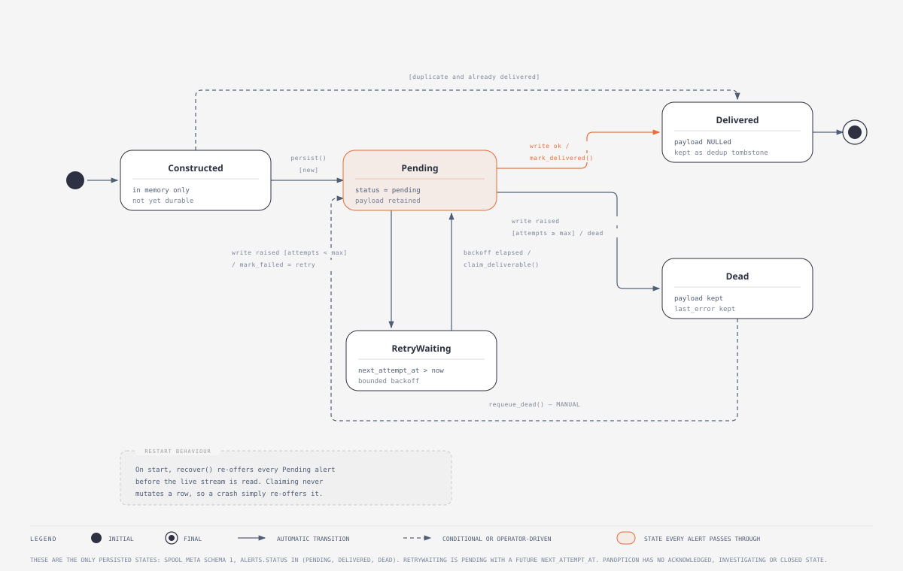

*Figure 19: Alert Lifecycle State Machine ([Interactive HTML](uml/state/panopticon-alert-lifecycle-state.html) · [Vector SVG](uml/state/panopticon-alert-lifecycle-state.svg) · [High-Res PNG](uml/state/panopticon-alert-lifecycle-state.png))*

#### Platform & Response Use Cases
Actor use cases modeling streaming telemetry, live alert triage, response action staging, analyst authorization, and endpoint execution evidence submission.


*Figure 20: Platform & Response Use Cases ([Interactive HTML](manager-capstone-set/04-use-case.html) · [Vector SVG](manager-capstone-set/04-use-case.svg) · [High-Res PNG](manager-capstone-set/04-use-case.png))*

#### System Role Use Cases
Detailed boundary diagram for Security Analyst, Detection Engineer, and Security Admin with documented boundary exclusions.

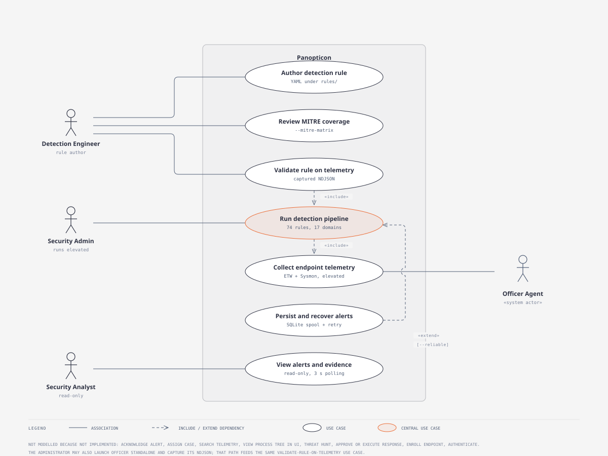

*Figure 21: System Role Use Cases ([Interactive HTML](uml/use-case/panopticon-use-case.html) · [Vector SVG](uml/use-case/panopticon-use-case.svg) · [High-Res PNG](uml/use-case/panopticon-use-case.png))*

#### Elevated Endpoint Deployment Model
Physical and logical deployment model mapping artifacts, processes, execution privileges, and security boundaries on Windows endpoints.

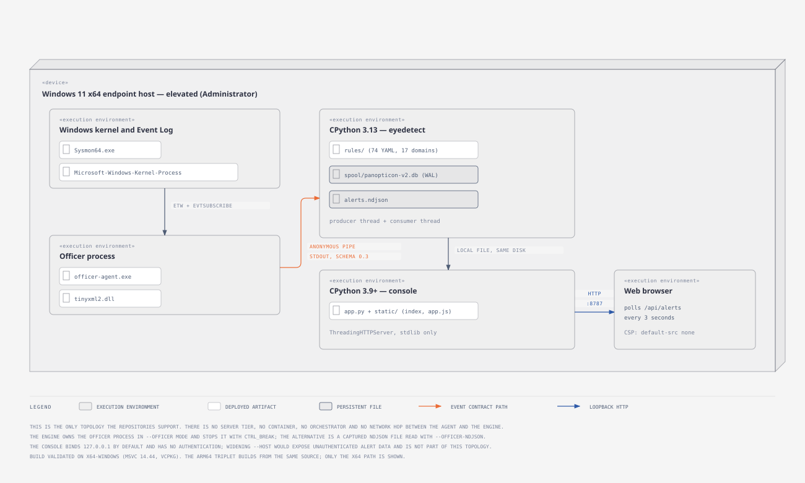

*Figure 22: Elevated Host Deployment Model ([Interactive HTML](uml/deployment/panopticon-deployment.html) · [Vector SVG](uml/deployment/panopticon-deployment.svg) · [High-Res PNG](uml/deployment/panopticon-deployment.png))*

---

## Which diagrams describe what

| Status | Where it appears |
|---|---|
| **Current implementation** | All twenty-two diagrams. Every solid-stroke element exists in the working tree and is covered by automated consistency checks. |
| **Designed, not implemented** | Only three places, always dashed and tagged: the backend panel in the high-level architecture, the designed response chain in the response sequence, and the restart note in the state machine. |
| **Simulated** | Zero places. Legacy simulated remediation drafts have been replaced by the implemented closed response loop. |
| **Planned only (roadmap)** | Nowhere. Roadmap items with no design document are excluded from the set entirely. |

No diagram shows an unimplemented element without a dashed stroke and a tag. That rule is
the single most important thing to preserve when updating this set.

---

## Source-of-truth rules

Diagrams follow this order, and the implementation wins over documentation whenever the two
disagree:

1. Approved ADRs, such as `panopticon-agent/docs/adr/003-process-entity-id.md` and `manager/docs/adr/002-wire-protocol-ack-semantics.md`
2. Canonical schemas in `panopticon-contracts` (Schemas 0.1 through 0.5)
3. Architecture documents in all organization repositories
4. The current implementation across `panopticon-agent`, `panopticon-linux-agent`, `panopticon-manager`, `panopticon-detection-engine`, `panopticon-response-engine`, and `panopticon-console`
5. Component `README.md` and `CLAUDE.md` files
6. Roadmap documents

---

## Naming conventions

- Files are `panopticon-<subject>.html` or `NN-<subject>.html`, kebab-case, matching the `<title>` and the
  `aria-labelledby` identifier prefix inside the file.
- Component names are canonical and never paraphrased: **Officer** (the Windows agent),
  **panopticon-linux-agent** (the Linux agent), **eyedetect** (the detection engine),
  **panopticon-response-engine** (the response policy engine), **Panopticon Manager** (control plane),
  **Panopticon Console**, and **Panopticon Event**.
- Class and function names are reproduced exactly as they appear in source.
- A **Detection** is a `DetectionResult`. An **Alert** is the persisted record. A
  **response recommendation** is an `ActiveResponseAction`. These three are never used
  interchangeably.

Full terminology table: `DIAGRAM_SPECIFICATION.md` §5.

---

## Architecture diagrams versus UML diagrams

The set deliberately mixes two notations.

- **Architecture notation** is used for the context and high-level architecture diagrams,
  and for the investigation scenario. These answer "how is the system arranged" and use
  zones, typed node fills and labelled connectors. They are not UML and do not pretend to
  be.
- **UML notation** is used wherever the diagram is named UML, and its semantics are
  preserved exactly: hollow triangles for realization, filled diamonds for composition,
  hollow diamonds for aggregation, open arrowheads for dependencies, stick-figure actors
  with ellipse use cases, lifelines with activation bars and combined fragments, initial
  and final pseudostates, fork and join bars, and three-dimensional device nodes.

Where a UML rule and a visual preference conflicted, the UML rule won. For example activity
nodes use a larger corner radius than the rest of the set, because a UML activity must read
as a rounded node rather than a box.

---

## How the diagrams were generated

Each `.html` file is hand-authored inline SVG produced with the **diagram-design** skill,
using its shipped editorial skin unmodified as the Panopticon visual identity. That skin is
light, high-contrast, and prints and projects reliably; consistency across the set is what
gives the identity, not a bespoke palette. Every file passes the skill's
`scripts/self_check.py`, which enforces the accessible-SVG contract and single-file safety.

No diagram uses JavaScript. No diagram loads a remote asset other than the Google Fonts
stylesheet.

---

## Regenerating a diagram

1. Read `DIAGRAM_SPECIFICATION.md` first, especially §6 (cross-diagram consistency rules).
2. Edit the `.html` file directly. It is the source; the `.svg` and `.png` are derived.
3. Verify the file still passes the skill's self-check:

```bash
python "$SKILL/scripts/self_check.py" path/to/diagram.html
```

where `$SKILL` is the installed `diagram-design` skill directory.

4. Re-export the `.svg` and `.png` (below).
5. Open the `.png` and look at it. A diagram that passes the self-check can still have a
   label sitting on a connector or a line crossing a box.
6. If the change affects a shared fact (a class name, a field, a count, a direction of
   flow), check every other diagram listed in `DIAGRAM_SPECIFICATION.md` §11 for the same
   fact.

---

## How to export

Both exports are derived from the `.html` source and are safe to regenerate at any time.

**SVG** — extracts the first `<svg>` node, converts HTML named entities to numeric
references so the file is well-formed XML, injects the Google Fonts `@import`, and writes
`<basename>.svg` beside the source.

**PNG** — renders the `.html` in headless Chromium/Edge and screenshots the `<svg>` element with
a transparent background at `device_scale_factor=2`. Requires Playwright:

```bash
pip install playwright
```

Use scale 2 for documents and slides, and 3 for print handouts. Never scale below 1.

Both helper scripts ship in [`_tooling/`](_tooling/) and take a directory, processing every
`.html` under it recursively:

```bash
# from the repository root
python _tooling/export_svg.py .        # writes every .svg
python _tooling/export_png.py . 2      # writes every .png at 2x
```

---

## Verifying the set

[`_tooling/validate.py`](_tooling/validate.py) is the automated consistency gate. It runs
386 checks against the source repositories and fails loudly on any drift. It expects
`panopticon-agent`, `panopticon-detection-engine`, `panopticon-manager`, and `panopticon-console`
checked out as siblings of this repository — clone all Panopticon-Co repositories into one parent
directory and it finds them automatically:

```bash
python _tooling/validate.py
```

If your clones live elsewhere, point it at the parent directory that contains all repositories:

```bash
PANOPTICON_WORKSPACE=/path/to/that/parent/directory python _tooling/validate.py
```

It verifies that every one of the 88 class, method and attribute names asserted anywhere in
the set exists in source; that every schema field named in the data-model diagram exists in
`event.schema.json` with the stated enum and nullability; that the stated counts still hold
(74 rules, 17 rule domains, 14 comparison operators, queue capacity 1024, poll interval
3000 ms, port 8787); that the spool status constants are unchanged; that
closed-loop response actions adhere to the 7-action contract and tier classifications; and
that no diagram reintroduces a banned term such as "named pipe" or "84+".

---

## Known limitations

- **No performance data is drawn.** The agent's documented event-loss behaviour under very
  high Sysmon event-ID-1 rates is a reliability property, not a structural one.
- **The 74 rules are represented structurally, not enumerated.** A rule catalogue is a
  table.
- **ARM64 is not drawn separately.** The build is triplet-driven and structurally identical;
  only the validated x64 path is shown.
- **Error paths are not exhaustive.** Each sequence shows the success path plus the one
  failure branch that changes persisted state.

Full list: `DIAGRAM_SPECIFICATION.md` §10.

---

## Suggested use

| Audience | Diagrams |
|---|---|
| Interim report | System context, high-level architecture, event data model |
| Final report | All twenty-two, grouped as context, UML, data, investigation, and capstone |
| Presentation or demo | Capstone architecture, Capstone sequence, Capstone activity, attack investigation scenario |
| Onboarding a new contributor | Component, then the two class models, then the telemetry collection sequence |
| Defending the response boundary | Closed-loop response sequence, then `DIAGRAM_SPECIFICATION.md` §9 row 1 |

---

## Related repositories

This repository is the canonical, versioned diagram source for the Panopticon&Co platform
and is referenced from the other repositories' own documentation. It diagrams:

- [`panopticon-agent`](https://github.com/Panopticon-Co/panopticon-agent) — the Windows endpoint agent ("Officer")
- [`panopticon-linux-agent`](https://github.com/Panopticon-Co/panopticon-linux-agent) — the Linux endpoint agent (procfs/eBPF)
- [`panopticon-detection-engine`](https://github.com/Panopticon-Co/panopticon-detection-engine) — the detection/correlation engine ("eyedetect")
- [`panopticon-response-engine`](https://github.com/Panopticon-Co/panopticon-response-engine) — the closed seven-action response domain package
- [`panopticon-manager`](https://github.com/Panopticon-Co/panopticon-manager) — the FastAPI backend: ingestion, authorization, dispatch, and lifecycle
- [`panopticon-console`](https://github.com/Panopticon-Co/panopticon-console) — the alert and response action dashboard
- [`panopticon-contracts`](https://github.com/Panopticon-Co/panopticon-contracts) — the schemas (0.1 through 0.5)

Organization: [Panopticon-Co](https://github.com/Panopticon-Co)

---

## Contributing, security, and license

- **Contributing:** see [`CONTRIBUTING.md`](CONTRIBUTING.md) for the actual diagram workflow
  — there is no diagram-DSL compiler here, only hand-authored HTML/SVG plus the two export
  scripts and the consistency validator described above.
- **Security:** see [`SECURITY.md`](SECURITY.md). Report privately via
  [GitHub Security Advisories](https://github.com/Panopticon-Co/panopticon-diagrams/security/advisories/new),
  never via a public issue.
- **Code of conduct:** see [`CODE_OF_CONDUCT.md`](CODE_OF_CONDUCT.md) (Contributor
  Covenant v2.1).
- **License:** [MIT](LICENSE).
